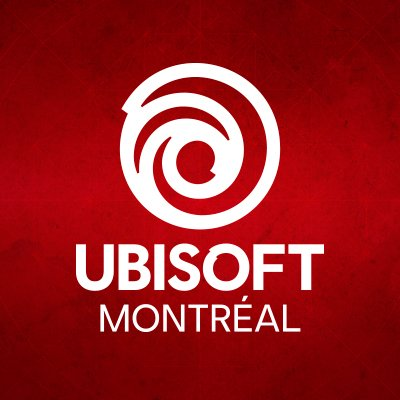
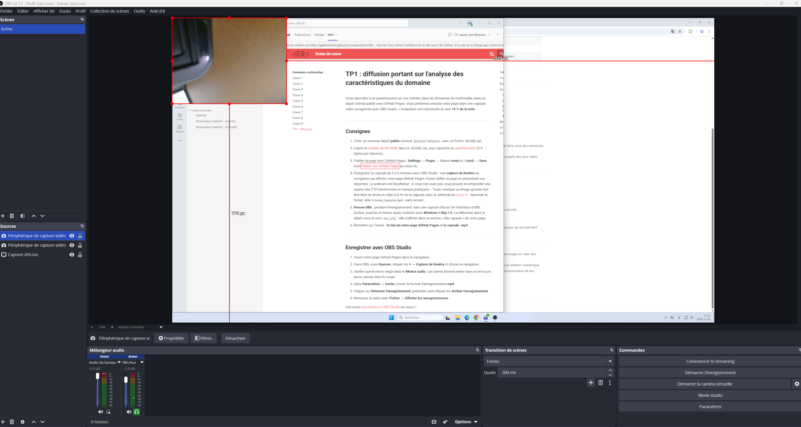

# Analyse du domaine — Naomi

## Découverte de soi

- Mes forces : esprit d'équipe, créative, curiosité, gentillesse, patience
    - Exemple :je suis curie sur comment animée des dessin 3d  
- Mes faiblesses ou points à améliorer : communication, confiance en moi, gestion du temps.
    - Exemple : je ne peux pas  parler
- Seul(e) ou en équipe : je peux travailler seule et je peux travailler en équipe.
    - Pourquoi et exemple : seule, je peux me concentre sur mes idées. En équipe, je peux partage mes idées et apprendre des autres
- Plutôt technique ou créatif : je dirait que je suis technique et creatif 

## Exploration des domaines

| Domaine | Intérêt | Pourquoi |
|---|---|---|
| Graphisme | Fort |  j'aime dessiner|
| Vidéo et animation 2D | fort  |j' aime le fait de donner vie a des personnage et dessin |
| 3D | fort|  je trouve intéressant de créer des objets et des personnages en trois dimension. |
| Web | moyen| j'aimerais apprendre à créer des sites web qui travail . |
| Jeux vidéo | fort | j'aime imaginer des personnage, des décor, des univers.   |
| Développement logiciel | moyen | j'aimerais apprendre à céer des application et des programmes. |
| Installations et expériences immersives | moyen |  |

## Mes 2 domaines préférés

### Domaine 1 : vidéo et animation 2D

- Expérience : moyen
- Logiciels et outils : cap Cut, Tablet graphique, photoshop  
- Pourquoi il m'intéresse : Parce qu'il me permet d'utiliser  mon imagination et ma créativité.
- Travailler dans ce domaine : j'aimerais donner  vie a des personnage que j'ai créer .  

### Domaine 2 : jeux vidéo 

- Expérience : aucune 
- Logiciels et outils : Unity, Game Maker studio, photoshop
- Pourquoi il m'intéresse : ce domaine m'intéresse parce qu'il me permet de créer des monde  imaginaire et de faire vivre des aventures aux joueurs.
- Travailler dans ce domaine :j'aimerais participer a la création des personnage, des décors et de l'apparence visuelle des jeux vidéo.

## Les caractéristiques de mon domaine préféré

- Types d'entreprises :studios de dévéloppement.
- Exemple d'entreprise : Ubisoft Montréal.

(source de l'image : Google)

- Types de produits et de services : Ubisoft est l'un des plus grands développeurs et éditeurs de jeux vidéo au monde.
- Étapes de production :   Idéation,recherche, Préproduction,Production ,Postproduction , Opération  .
- Type d'emploi visé : concepteur de niveaux
- Étapes pour obtenir cet emploi : obtenir la formation adéquate, créer un portfolio, postuler et passer le processus de recrutement Ubisoft.

## Conclusion

- Mon profil en une phrase : Je suis une personne créative et imaginative qui aime dessiner, inventer des personnages et créer des univers.
- Ce qui m'a surpris : j'ai découvert qu'il existe plusieurs domaines différents qui permettent de travailler dans la création numérique.
- Ma force principale et la faiblesse à travailler : Ma force principale est ma créativité. Je dois améliorer ma communication et ma confiance en moi.
- Mon action d'ici la fin de la session : Apprendre à utiliser les logiciels .

## Ma capsule

